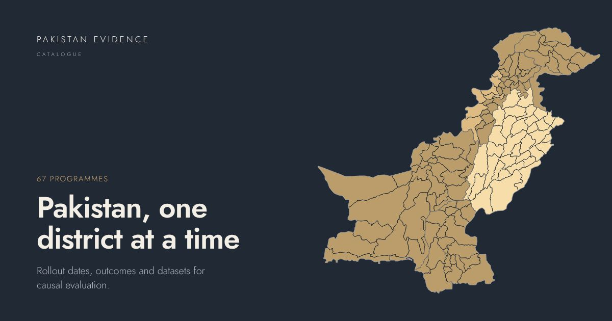

# Pakistan Evidence Catalogue

**67 public programmes and natural experiments in Pakistan that reached districts at different times**, with the
rollout dates, outcomes and datasets needed to evaluate them.

Live site: **https://itssaqib.github.io/pakistan-evidence-catalogue/**

## What is in it

| | |
|---|---|
| Programmes and natural experiments | 67, each with rollout window, unit, assignment rule, timing source, graded timing-data quality, threats, evidence status |
| Programme–outcome pairs | 322, each with mechanism, expected direction, datasets and feasibility |
| Outcome definitions | 102 |
| Datasets | 55, with coverage, district identifier, access route and panel readiness |
| Documented rollout districts | 13 entries, every phase sourced |
| District crosswalk | 200 name variants onto 126 constant 2019 boundary units, plus a lineage table of later districts |
| Stata kit | harmonisation, Callaway–Sant'Anna, Sun–Abraham, Borusyak–Jaravel–Spiess, de Chaisemartin–D'Haultfœuille, HonestDiD, power |

## The site

- **Programmes**: filter by domain, province, timing data, evidence, rollout unit, design, map and type; grid or table; CSV export.
- **Programme pages**: a district map that replays documented phases, the rollout timeline with sources, identification,
  outcomes with datasets, survey waves against the rollout window, a power calculator and a generated Stata do-file.
- **Atlas**: every district, three layers (programme scope by year, documented rollout, boundary notes); click a district
  to list the programmes that reached it.
- **Insights**: opportunity matrix, rollout timelines, start years, outcome coverage heatmap, dataset usage, survey calendar.
- **Datasets**, **Toolkit** (downloads, crosswalk, Stata kit, power), **Guide** (methods, treatment dates, caveats).
- Search everything with `/` or Ctrl+K. Save entries to a shortlist and compare them side by side.
- Claim an idea or suggest a correction through GitHub issue forms; open claims show on the programme page.

Documented footprints: P07 Zewar-e-Taleem, P14 KP Sehat Card Plus, P15 Punjab health card, P16 Contracting out health units, P17 PHFMC outsourcing, P18 Rescue 1122, P24 PEF Education Vouchers, P33 Punjab Skills Development Fund, P40 Punjab Safe Cities, P42 FATA–KP merger, P43 New district creation, P58 Military operations, P64 2005 earthquake.

## Files

| Path | Contents |
|---|---|
| `data/programmes.csv`, `.dta` | one row per entry |
| `data/programme_outcome_matrix.csv`, `.dta` | one row per programme–outcome pair |
| `data/outcomes.csv`, `data/datasets.csv` | outcome taxonomy, dataset catalogue |
| `data/documented_footprints.csv`, `.dta` | programme × phase × district, with source |
| `data/districts/` | crosswalk (`.csv`, `.dta`), boundary units, lineage |
| `data/catalogue.json` | everything, nested |
| `data/references.bib` | BibTeX |
| `toolkit/stata/`, `toolkit/pec-stata-kit.zip` | Stata starter kit |
| `paper/pec-data-note.pdf` | five-page data note (LaTeX source alongside) |

## Preview and publish

Open `index.html` directly, or serve the folder: `python3 -m http.server 8000`. To publish, run `./publish.sh`
(macOS, Linux) or `.\publish.ps1` (Windows), or use the VS Code task *Publish to GitHub*. Then, once:
Settings → Pages → Deploy from a branch → `main` / root.

To rebuild from data, see [`_build/README.md`](_build/README.md).

## Caveats

- Secondary sources disagree on dates routinely. Check every date against the primary source named on the programme page.
- Expected directions are hypotheses, not findings. Nothing here has been estimated.
- Boundaries are geoBoundaries 2019: Punjab shows 34 units, Azad Kashmir and Karachi are single units, and Larkana is not a
  separate polygon. Boundaries do not imply any judgement on the status of any territory; the status of Jammu and Kashmir is disputed.
- Coverage is uneven: Punjab documents its programmes far better than Balochistan or Gilgit-Baltistan.
- Several references could not be verified and are marked as such; replication status of published studies is not assessed.

## Changes in 2.0.0

- New design, a district map for every entry, the atlas, the insights page and the toolkit.
- Documented rollout districts with sources for 13 entries; district crosswalk and lineage on constant boundaries.
- Stata kit, per-programme do-files, `.dta` exports, power calculator, data note.
- Evidence status, related entries and dataset panel-readiness for every record.
- Corrected P14 KP Sehat Card Plus: v2.0: pilot districts named. Source: Dawn, 16 December 2015.
- Corrected P33 Punjab Skills Development Fund: v2.0 correction: v1.0 listed Rahim Yar Khan instead of Muzaffargarh and dated the start to 2010. Source: PSDF Newsletter 2012, Vol. I.
- Corrected P40 Punjab Safe Cities: v2.0 correction: v1.0 omitted Kasur. Source: Punjab Police press release, 2 January 2019.

Version 1 addresses (`/matrix/`, `/outcomes/`, `/methods/`, `/timing/`, `/caveats/`, `/data/`) redirect to their new pages.

## Cite

> Hussain, S. (2026). *Pakistan Evidence Catalogue: staggered district-level programmes for causal impact evaluation*,
> version 2.0.0. https://itssaqib.github.io/pakistan-evidence-catalogue/

GitHub's *Cite this repository* button reads `CITATION.cff`. `.zenodo.json` is ready for a Zenodo DOI: connect the repository
at zenodo.org, then publish a GitHub release.

## Licence and credits

Catalogue content CC BY 4.0; site code also MIT (see `LICENSE`). Boundaries: geoBoundaries (public domain).
Typeface: Jost, SIL Open Font Licence. The visual design follows the editorial conventions of film and culture sites:
white ground, a light geometric sans, centred section titles and one dark stage. No third-party brand assets are used.

Maintainer: Saqib Hussain, saqibhussain@kdis.ac.kr
